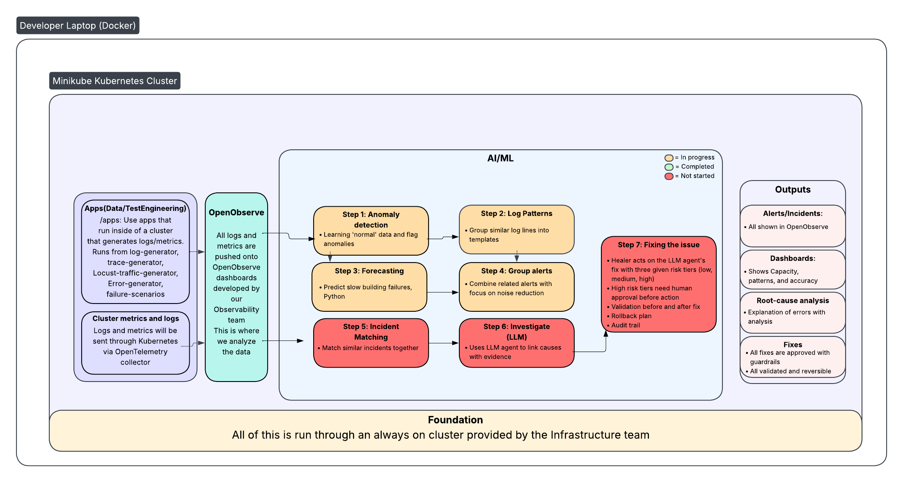

# AI/ML

Anomaly detection, log analysis, incident creation and investigation

## Ownership
This directory is maintained by the AI/ML team

## Purpose
The purpose of the AI/ML section is to contain documentation for the analysis that we run on logs. The goal is to detect anomalies, create incident logs, and explain failures while suggesting fixes in the system

We will be following this architectural outline for the foreseeable future 

## Directory Contents
- 'README.md' is this file 
- 'ai-diagram.png' is the architectural outline for the project

