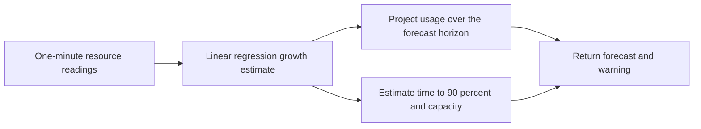

# Resource Forecasting v1

Initial Python prototype for forecasting slow-building resource problems, such as
disk growth or steadily increasing memory usage. It estimates future usage and
the time remaining before a resource reaches 90% usage or its capacity limit.

## Install

Use Python 3.10 or newer. The program uses only the Python standard library;
there are no additional packages, services, or Kubernetes resources to install.

## Run and check

From the repository root:

```bash
python ai/forecasting/forecast_v1.py
```

The built-in example represents one memory reading per minute, increasing from
500 MiB to 680 MiB with a 1,024 MiB container memory limit. Expected output:

```json
{
  "current_pct": 66.4,
  "forecast_pct": 95.7,
  "minutes_to_90_pct": 12.1,
  "minutes_to_limit": 17.2,
  "warning": true
}
```

The default forecast horizon is 15 minutes. A warning is true when current usage
or predicted usage reaches 90% of capacity. A time estimate is zero if the target
has already been reached, or `null` if usage is flat or falling below the target.
Forecast percentages may exceed 100%; this represents projected demand beyond
available capacity.

## How it works



`forecast_capacity(samples, capacity, horizon_minutes=15)` estimates a linear
growth rate and projects it forward from the latest actual reading. Supply at
least 10 finite, nonnegative readings, ordered oldest first and spaced exactly
one minute apart. Readings and capacity must use the same units, for example MiB
for memory or GiB for disk. Capacity and the forecast horizon must be positive.

Keep each history tied to one container, node, or filesystem and a consistent
capacity. Start a new history after a restart or capacity change. Do not replace
missing readings with zeros; prepare a complete history before calling the
function.

## Scope and next steps

This version runs on example data. It does not query OpenObserve, publish
forecasts, send alerts, or change cluster resources. The next integration step
is to read historical metrics from OpenObserve and publish forecast records for
dashboards and warnings.

The estimates assume a continuing linear trend. They are not a confidence score
or a guarantee of failure. Sudden failures need a separate fast detection path.
Latency, error-rate, and CPU forecasting need their own warning thresholds and
evaluation; this example demonstrates memory and disk capacity calculations.

Before using forecasts for operational alerts, evaluate gradual-growth scenarios
and historical data, measuring prediction error, warning lead time, and false
alarms. Compare against a baseline that predicts the latest reading will remain
unchanged.

## Remove

Remove `ai/forecasting/` and its entry in `ai/README.md`. There are no installed
packages or cluster resources to clean up.
