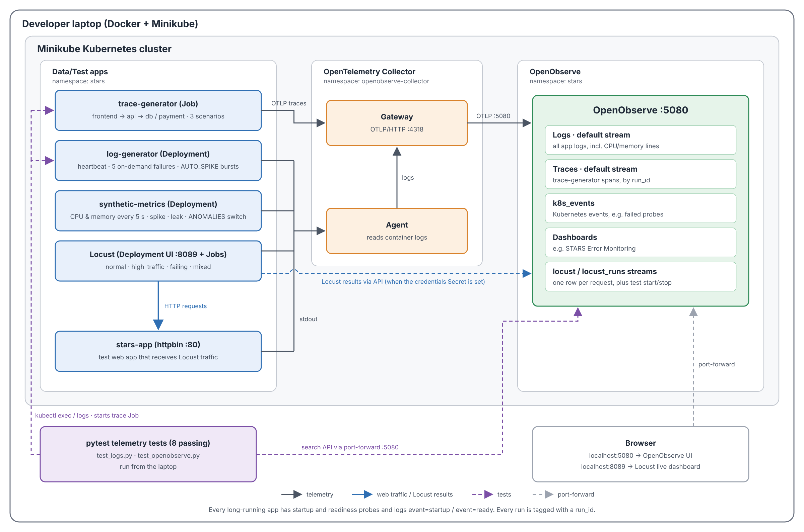

# Apps (Data/Test Engineering)

This folder holds the Data/Test Engineering team's work for the STARS sandbox. Together, these folders **create** realistic telemetry and failures, **record** what the results should be, and **check** that everything reaches OpenObserve.



---

## What each folder does

### [log-generator](log-generator/)

A small app that writes log messages, including a "heartbeat" every 5 seconds that shows it is alive. On command, it fakes problems: a warning, an error, a burst of 20 errors, a connection failure, or a crash. It can also create automatic error bursts on its own (`AUTO_SPIKE=true`). Every problem is tagged with a `run_id`, so we know exactly which log lines it should produce. This is how we test that logs and failures show up correctly in OpenObserve.

### [synthetic-metrics](synthetic-metrics/)

A small app that reports fake CPU and memory usage every 5 seconds. Most of the time the numbers look healthy, but on a schedule it shows a CPU spike (every 5 minutes) or a slow memory leak (minutes 35–50 of each hour). The problems can be turned off with `ANOMALIES=off` to record purely normal data. This gives us the metrics signal for dashboards, and later gives the AI/ML team examples of normal and abnormal behavior.

### [trace-generator](trace-generator/)

Creates fake traces: records of one request traveling through four pretend services (frontend, api, database and payment). It has three scenarios: `normal`, `slow-db` (the database is slow) and `payment-errors` (the payment service fails). This shows how a problem in one service affects the services around it. The Observability team uses it to test tracing in OpenObserve, and it sets up root-cause analysis later in the project.

### [Locust](Locust/)

Our traffic generator. It sends fake website visits to a test app (`stars-app`, running httpbin) so OpenObserve has real activity to monitor. It can act like normal users, a sudden crowd of users, users who hit errors and slow pages, or a mix of all three. Each run gets a `run_id`, so its results can be found later in OpenObserve. Unlike the other generators, a real app does real work here, which makes this the most realistic data we have.

### [failure-scenarios](failure-scenarios/)

A written catalog of every problem our generators can create. For each one, it lists how to trigger it, the exact log lines that should appear, and how to tell whether it passed. Think of it as the answer key: it says what *should* happen. Our tests are built from it, and later phases will score the AI's problem detection against it.

### [tests](tests/telemetry-validation/)

Automated tests that trigger problems and check the results on their own, with no one watching logs by hand. They prove what *does* happen: the log generator behaves as the catalog says, and logs, metrics and traces actually arrive in OpenObserve. The latest results are saved in [`test-results.xml`](tests/telemetry-validation/test-results.xml), our team's proof that everything works.

---

## Telemetry at a glance

| Generator | Sends | How it reaches OpenObserve | Where to find it in OpenObserve |
|---|---|---|---|
| log-generator | Logs | Container logs → collector Agent → Gateway | **Logs**, `default` stream: `k8s_container_name = 'log-generator'` |
| synthetic-metrics | Metrics (CPU and memory, as log lines) | Container logs → collector Agent → Gateway | **Logs**, `default` stream: `k8s_container_name = 'synthetic-metrics'` |
| trace-generator | Traces | OpenTelemetry (OTLP) straight to the collector Gateway, port 4318 | **Traces**, `default` stream: filter by `run_id` |
| Locust | Web traffic and test results | Container logs through the collector; results sent straight to OpenObserve's API (when the credentials Secret is set) | **Logs**, `locust` stream (one row per request) and `locust_runs` (test start and stop) |
| stars-app | Request logs (the app Locust tests) | Container logs → collector Agent → Gateway | **Logs**, `default` stream: `k8s_container_name = 'httpbin'` (the container's name inside `stars-app`) |

All long-running apps have Kubernetes startup and readiness checks, and log these two lines so the Observability team can measure startup time:

```text
<UTC time> level=INFO service=<app name> event=startup message="Process started" run_id=<RUN_ID>
<UTC time> level=INFO service=<app name> event=ready message="Ready to serve" run_id=<RUN_ID>
```

---

## Getting started

Everything runs in the `stars` namespace on Minikube. Commands work the same in macOS Terminal and Windows PowerShell unless a README shows both.

1. **Set up the platform first** (once per cluster):
   1. Minikube and the `stars` namespace: [`infrastructure/README.md`](../infrastructure/README.md)
   2. OpenObserve: [`observability/install.md`](../observability/install.md)
   3. The collector: [`observability/collector.md`](../observability/collector.md)
2. **Start the generators** you need, using each folder's README. A good order:
   1. [log-generator](log-generator/), the quickest check that logs reach OpenObserve
   2. [synthetic-metrics](synthetic-metrics/)
   3. [trace-generator](trace-generator/), a short run that stops by itself
   4. [Locust](Locust/), which also deploys `stars-app`
3. **Open OpenObserve** to see the data:
   ```bash
   kubectl port-forward -n stars svc/openobserve-openobserve-standalone 5080:5080
   ```
   Then go to <http://localhost:5080> and log in with the credentials from your `observability/values.local.yaml`.
4. **Run the tests** to confirm everything works: [`tests/telemetry-validation/README.md`](tests/telemetry-validation/README.md).
5. **Trigger a failure scenario** and compare the result with the [failure catalog](failure-scenarios/).

---

## Conventions

- Use a **new `run_id`** for each run, so one search finds the whole run (letters, digits, `_` and `-`; up to 64 characters).
- Every README gives commands for both **Mac (Terminal)** and **Windows (PowerShell)** wherever they differ.
- Never commit passwords. OpenObserve logins live in your local `*.local.yaml` files, environment variables, or the `openobserve-credentials` Kubernetes Secret.
