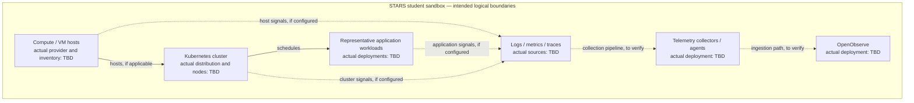

# Sandbox Infrastructure Architecture

> **Verification status:** Draft — repository and live-environment verification required.  
> **Tracking issue:** [stars-sandbox #38](https://github.com/Aerospace-x-Csula/stars-sandbox/issues/38)  
> **Scope:** STARS student sandbox only; not the STARS production environment.  
> **Last documentation review:** 2026-11-02 (project source documents only).

## Purpose and source of truth

This document inventories the sandbox's **deployed infrastructure** and the relationships among compute, Kubernetes, networking, storage, workloads, and observability. It complements [system-overview.md](system-overview.md), which should provide the broader system-level view.

**Important distinction:** The STARS project outline and proposal specify a *target* architecture; they do not prove that any component is currently running. At the time of this draft, the repository's `dev` branch, issue #38, and live cluster were not accessible for inspection. Consequently, none of the implementation-specific values below are asserted as verified. Replace each `TBD (verify)` entry with evidence from the repository or deployed sandbox before marking this document complete. Do not infer the environment from the project proposal alone.

## Architecture at a glance

The approved project scope is an isolated STARS-like environment with compute/VMs, a Kubernetes layer, sample applications and synthetic traffic, telemetry collection, and OpenObserve for observability. AI investigation and controlled remediation are intended integrations, **not verified current deployments**.



**Diagram key:** Solid arrows express the intended dependency pattern. Dashed arrows are intended telemetry integrations; their implementation is not confirmed. This is a *logical reference diagram*, not an as-built topology.

## 1. Environment boundary and compute

| Item | As-built value | Where to verify |
| --- | --- | --- |
| Sandbox hosting location / provider | TBD (verify) | Infrastructure provisioning files and infrastructure owner |
| Virtualization or cloud platform | TBD (verify) | VM provisioning configuration / host inventory |
| Number and purpose of VMs | TBD (verify) | VM inventory and live hosts |
| OS distribution and version | TBD (verify) | Machine configuration, `cat /etc/os-release` |
| vCPU, RAM, disk sizing | TBD (verify) | Provisioning definitions and host inventory |
| Access method / bastion / VPN | TBD (verify; no credentials here) | Onboarding / access runbook |
| Infrastructure-as-code implementation | TBD (verify) | Terraform, Ansible, scripts, or documented manual procedure |

Describe whether Kubernetes runs directly on VMs, on bare metal, or in a managed service *after* checking the actual setup. Distinguish infrastructure currently present from proposed expansion.

## 2. Kubernetes and container runtime

| Item | As-built value | Evidence to capture |
| --- | --- | --- |
| Cluster name and Kubernetes distribution/version | TBD (verify) | `kubectl cluster-info`, `kubectl version` |
| Control-plane node count and names | TBD (verify) | `kubectl get nodes -o wide` |
| Worker node count and names | TBD (verify) | `kubectl get nodes -o wide` |
| Node OS, architecture, and container runtime | TBD (verify) | `kubectl get nodes -o wide` and node description |
| Namespaces and their owners | TBD (verify) | `kubectl get namespaces` |
| Deployed Helm releases / manifests | TBD (verify) | `helm list -A`, manifests and chart values in repo |
| Ingress controller, service exposure and load balancing | TBD (verify) | `kubectl get ingress,svc -A` and installed controllers |
| DNS, CNI, network policies | TBD (verify) | cluster add-ons, `kubectl get networkpolicy -A` |
| Resource limits, probes and scaling settings | TBD (verify) | workload manifests and live deployment descriptions |

Record the distinction between **control plane** (Kubernetes API, scheduling and cluster state) and **worker/data plane** (pods and services), including any shared-node arrangement used by this sandbox. Do not assume a high-availability control plane.

## 3. Network architecture and traffic paths

Current topology, IP/CIDR ranges, DNS names, firewall boundaries, ingress controller, externally exposed endpoints, and node-to-node connectivity are **TBD (verify)**. Document, without publishing secrets:

1. How operators reach the sandbox and Kubernetes API.
2. How users reach sample applications and OpenObserve (ingress, NodePort, LoadBalancer, reverse proxy, or port-forward, as actually configured).
3. How services reach one another inside the cluster, including DNS and any network-policy restrictions.
4. Which collectors initiate connections to the observability backend, including the actual protocol and port.
5. Any firewall, NAT, proxy, or external dependency needed for a clean rebuild.

**Observed traffic-path inventory**

| Source | Destination | Protocol / port | Exposure / protection | Status |
| --- | --- | --- | --- | --- |
| Operator workstation | Kubernetes API | TBD | TBD | Unverified |
| User workstation | Sample application(s) | TBD | TBD | Unverified |
| User workstation | OpenObserve UI/API | TBD | TBD | Unverified |
| Workloads/collectors | OpenObserve ingestion | TBD | TBD | Unverified |

Do not commit credentials, private keys, tokens, or sensitive endpoint details to this public-facing document.

## 4. Storage and persistence

| Item | As-built value | Verification |
| --- | --- | --- |
| Node root/ephemeral storage | TBD (verify) | Node provisioning |
| Storage classes and default class | TBD (verify) | `kubectl get storageclass` |
| PersistentVolumes and PersistentVolumeClaims | TBD (verify) | `kubectl get pv,pvc -A` |
| OpenObserve data storage/backend | TBD (verify) | Helm values/manifests and running pods |
| Data retention and disk capacity | TBD (verify) | Effective settings, observed utilization |
| Backup, restore and disaster recovery procedure | TBD (verify) | Runbooks and successful restore-test evidence |

Explicitly note whether data is ephemeral and what is lost on node replacement or cluster rebuild. A PVC existing does not, by itself, establish backup coverage.

## 5. Deployed workloads and observability

The project calls for sample applications, synthetic traffic/failure injection, and OpenObserve receiving infrastructure and application telemetry. These are **project goals, not proof of deployment**.

| Component | Namespace / location | Deployment mechanism | Signal or purpose | Live status |
| --- | --- | --- | --- | --- |
| Sample application(s) | TBD | TBD | Representative workload | Unverified |
| Synthetic load / telemetry generator | TBD | TBD | Controlled normal and failure scenarios | Unverified |
| Kubernetes and/or VM metric collector(s) | TBD | TBD | Metrics | Unverified |
| Log collector(s) | TBD | TBD | Logs | Unverified |
| Trace instrumentation / collector(s) | TBD | TBD | Traces, if supported | Unverified |
| OpenObserve | TBD | TBD | Ingest, store, query and visualize telemetry | Unverified |
| AI/alerting/RCA/remediation services | TBD | TBD | Future or current: verify individually | Unverified |

For each deployed signal, record the **actual** source → collector → processor/forwarder (if any) → OpenObserve ingestion endpoint → stream/index/dashboard path. Capture collection method, service identity labels, timestamp conventions and retention only after confirming effective configuration. Avoid depicting AI detection or automatic remediation as operational without test evidence.

## 6. Security and isolation

The STARS project explicitly limits student experimentation to the sandbox; production changes, sensitive training data, and high-risk autonomous actions require separate authorization. Actual implemented controls remain unverified. Confirm and document:

- Namespace and cluster-level RBAC, service accounts and least-privilege permissions.
- How secrets are injected and rotated; never put real secret values in Git or documentation.
- Network segmentation and exposed ingress paths.
- Image source/pinning, security contexts and other deployed hardening settings.
- Audit and approval boundaries for any remediation integration, plus rollback conditions.

A project requirement is not equivalent to a deployed security control; link to the configuration and tests that demonstrate each claim.

## 7. Deployment, rebuild, and operations

**Current deployment process:** TBD (verify from actual scripts, workflow files and maintainer instructions). For a reproducible as-built record, document the concrete sequence to provision compute, install/configure Kubernetes, apply storage/network add-ons, deploy applications, deploy collectors/OpenObserve, and validate telemetry. Point to exact versioned repository paths and required non-secret parameters.

### Read-only verification commands

Run with the intended sandbox kube-context and approved read permissions. **Check the context before issuing any commands**; avoid collecting secrets or publishing raw outputs with sensitive addresses.

```bash
kubectl config current-context
kubectl cluster-info
kubectl get nodes -o wide
kubectl get namespaces
kubectl get deployments,daemonsets,statefulsets -A
kubectl get pods -A -o wide
kubectl get services,ingresses -A
kubectl get storageclass,pv,pvc -A
kubectl get networkpolicies -A
helm list -A
```

Additional evidence can come from `kubectl describe`, Helm release values (redact credentials), IaC plans and project workflows. To validate observability, generate a *known safe test event*, locate it in the expected OpenObserve stream, and record the query and timestamp without exposing tokens.

## 8. Known gaps and validation checklist

- [ ] Read [issue #38](https://github.com/Aerospace-x-Csula/stars-sandbox/issues/38) and incorporate its acceptance criteria.
- [ ] Reconcile content and terminology with [system-overview.md](system-overview.md) on the `dev` branch.
- [ ] Inspect repo provisioning, Helm, Kubernetes manifests, scripts and CI workflows; link exact paths and commits.
- [ ] Get infrastructure owner to verify the host/VM inventory and resource sizing.
- [ ] Verify node roles, namespaces, deployments and cluster/runtime versions against live read-only output.
- [ ] Verify network topology, ingress/DNS, exposed ports and traffic directions.
- [ ] Verify storage classes, OpenObserve persistence, retention and restoration expectations.
- [ ] Confirm which telemetry signals and automation services are *actually working*, not just configured.
- [ ] Add an **as-built** Mermaid topology with the actual components and links, replacing the logical reference diagram.
- [ ] Review security-sensitive details, then obtain infrastructure/observability peer review.

## References

- [Issue #38 — infrastructure architecture documentation](https://github.com/Aerospace-x-Csula/stars-sandbox/issues/38) (not accessible for verification during drafting).
- [System overview on `dev`](https://github.com/Aerospace-x-Csula/stars-sandbox/blob/dev/docs/architecture/system-overview.md) (not accessible for verification during drafting).
- *STARS AI-Powered Observability Platform — CSULA x STARS Student Project Outline & Technical Work Plan*, especially §§3, 6–9, 13, 20 (requirements and target design only).
- *STARS AI-Powered Observability Platform — Project Proposal*, Scope and Expected Outcomes (planned outcomes only).
