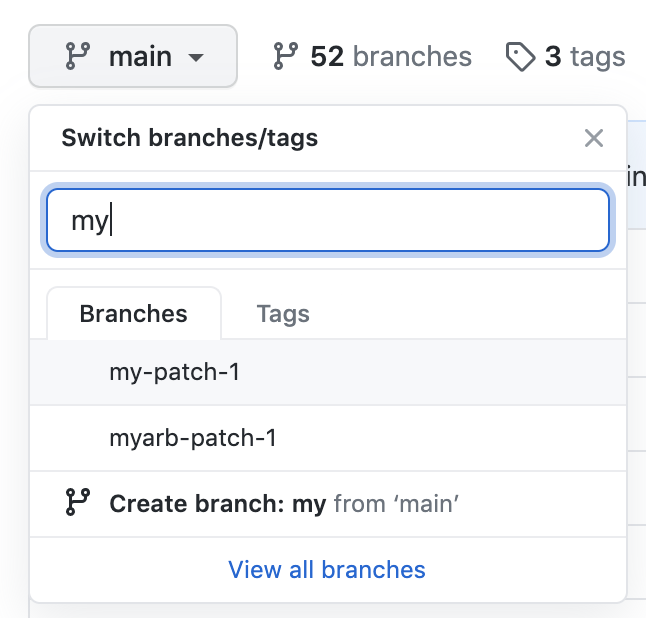
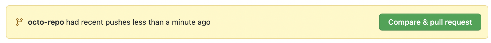
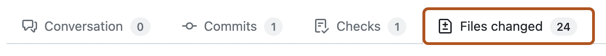
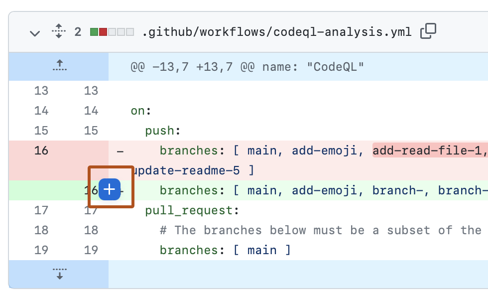
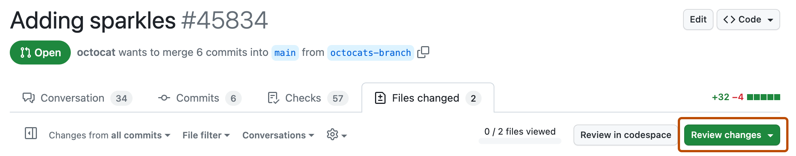
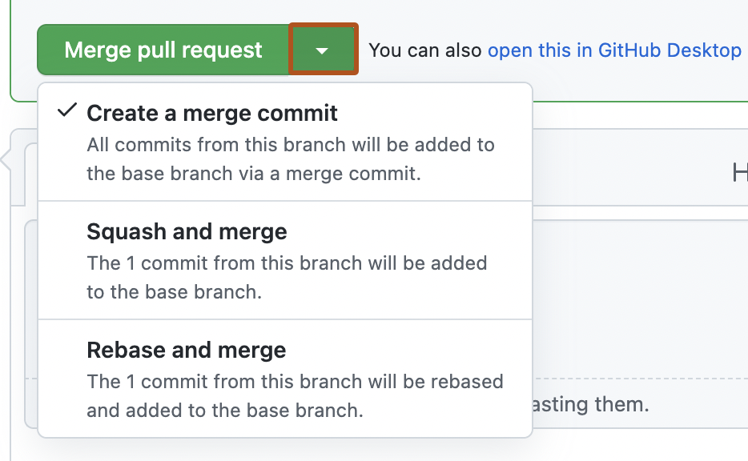

# Pull Request Guide

How a team's work gets from its team branch into `main`. The full rules are in [CONTRIBUTING.md](https://github.com/Aerospace-x-Csula/stars-sandbox/blob/main/CONTRIBUTING.md).

| Who | What they do |
|---|---|
| A team member | Opens the team PR |
| Teammates | Review and comment |
| Sub-lead (code owner) | Approves |
| Jonas or Moises | Final approval and merge |

The PR must be ready by the Sunday before the biweekly Monday leads meeting. It merges at that meeting.

## 1. Open the team PR (team member)

A team member opens the PR, not the sub-lead. GitHub doesn't let the person who opened a PR approve it, and the sub-lead's approval is required.

1. Make sure your team branch is up to date with `main` (see step 4).
2. On the repo's main page, choose your team branch in the **Branch** menu.

   

3. Click **Compare & pull request** in the yellow banner. If there's no banner, go to **Pull requests** and click **New pull request**.

   

4. Set **base** to `main` and **compare** to your team branch.
5. Fill in the PR template.
6. Click **Create pull request**.

GitHub adds your sub-lead as a reviewer automatically. If the PR changes another team's folder, that team's sub-lead is added too and must also approve.

## 2. Review and approve (teammates and sub-lead)

1. Open the PR and click **Files changed**.

   

2. To comment on a line, hover over it and click the blue **+**.

   

3. When you're done, click **Review changes**.

   

4. Write a short summary, then choose one:
   - **Comment**: feedback only. Teammates use this.
   - **Approve**: the sub-lead uses this when the PR is ready to merge.
   - **Request changes**: blocks the merge until it's fixed.
5. Click **Submit review**.

An approval only counts if you click the button. A new commit clears all approvals, so approve again after changes.

## 3. Final approval and merge (Jonas or Moises)

The merge button unlocks after 2 approvals, including the sub-lead's. Only Jonas and Moises can merge. If one of them wrote code in the PR or approved it as sub-lead, the other one merges.

1. Approve the PR (step 2) so the final approval is on record.
2. At the bottom of the PR, open the merge menu and choose **Create a merge commit**. Don't squash: team branches keep being used after each release.

   

3. Click **Merge pull request**, then **Confirm merge**.
4. Don't click **Delete branch**. The team branch stays.

## 4. After each release: update your team branch

Run from the repo root:

```
git checkout <team-branch>
git pull
git pull origin main
git push
```

## Credits

Screenshots and some steps are from GitHub Docs, © GitHub, Inc., licensed under [CC BY 4.0](https://creativecommons.org/licenses/by/4.0/). The steps were shortened and adapted to our process. The screenshots are unchanged.

- [Creating a pull request](https://docs.github.com/en/pull-requests/how-tos/create-pull-requests/creating-a-pull-request)
- [Reviewing proposed changes in a pull request](https://docs.github.com/en/pull-requests/how-tos/review-pull-requests/reviewing-proposed-changes-in-a-pull-request)
- [Merging a pull request](https://docs.github.com/en/pull-requests/how-tos/merge-and-close-pull-requests/merging-a-pull-request)
